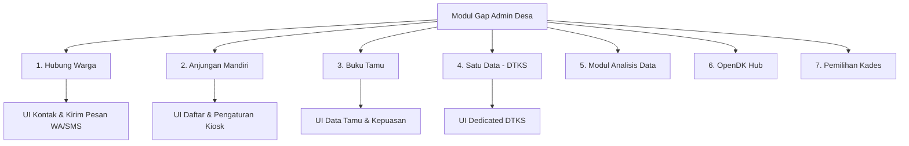

# Laporan Audit Konsistensi Internal & Paritas OpenSID vs Appdes (Admin Desa)

**Tanggal Audit**: 27 November 2026  
**Ruang Lingkup**: Seluruh menu admin desa di `src/features/navigation/domain/menu-tampil.ts`, `src/features/multi-desa/domain/tenant-template-data.ts`, rute `src/app/(admin)/`, serta pembanding OpenSID di `D:\laragon\www\opensid`.

---

## 1. Ringkasan Eksekutif

| Dimensi Audit | Status | Catatan Utama |
|---|---|---|
| **Konsistensi Menu Tenant Baru** | **Sangat Baik** | 108 modul di `TENANT_TEMPLATE`. 0 tautan mati, 0 rute `/segera/`. 82 modul anak ber-URL valid 100% terdaftar di `RUTE_ADMIN_TERSEDIA`. |
| **Mekanisme Support Legacy** | **Sangat Baik** | Modul `/segera/[slug]` (32 modul) & `MODUL_DIHENTIKAN` terisolasi khusus tenant lama ber-database legacy. Tenant baru bersih. |
| **Paritas Fitur OpenSID** | **85% Covered** | Dari 24 grup OpenSID + 1 fitur Pemilihan: 16 Covered/Superset, 2 Intentional Replacement/Scope, 3 Partial, 4 Gap Utama. |
| **Kesiapan Domain/Infra Gap** | **Siap Dibuatkan UI** | 3 dari 4 gap utama (Hubung Warga, Anjungan, Buku Tamu) sudah memiliki arsitektur domain & infrastruktur di `src/features/layanan-warga/`. |
| **Kesehatan Codebase** | **100% Lulus** | `npm run typecheck` 0 error; **2.559 unit test lulus (314 file test)**; `eslint` 0 violation. |

---

## 2. Aturan & Prinsip Audit (Sesuai `AGENTS.md`)

1. **Prinsip Paritas**:
   Saat menyamakan menu dengan OpenSID, field dan cakupan datanya **harus setara dengan OpenSID**, sedangkan UI Appdes dibuat lebih modern, rapi, dan responsif. Pengelompokan visual/tab boleh disesuaikan agar lebih ergonomis.
2. **Tidak Menyalin Mentah-Mentah**:
   Tidak menyalin tampilan OpenSID 1:1, tetapi **tidak mengeliminasi field tanpa justifikasi eksplisit**.
3. **Isolasi Perubahan**:
   OpenSID di `D:\laragon\www\opensid` adalah rujukan **read-only**. Seluruh penyesuaian dilakukan di repositori Appdes.

---

## 3. Hasil Audit Menu Internal Appdes

### 3.1 Struktur Modul Tenant Baru (`TENANT_TEMPLATE`)
- **Total Modul dalam Katalog**: 108 Modul (18 Modul Grup + 90 Modul Non-Grup).
- **Grup Tampak (Visual Navigation)**: 11 grup
  - `profil-desa`, `kependudukan`, `kehadiran`, `layanan-surat`, `sekretariat`, `keuangan`, `pertanahan`, `pengaturan`, `layanan-mandiri`, `satu-data`, `pembangunan-aset`.
- **Grup Tersembunyi (RBAC Containers)**: 7 grup
  - `statistik`, `kesehatan`, `buku-administrasi-desa`, `pemetaan`, `hubung-warga`, `admin-web`, `buku-tamu`.
- **Modul Anak dengan URL (82 Modul)**:
  100% rute valid dan terdaftar pada rute terverifikasi (`RUTE_ADMIN_TERSEDIA` di `src/features/navigation/domain/menu-tampil.ts` yang berisi 141 rute utama dan 41 alias).
- **Modul Tersembunyi Sengaja (URL `null`)**: 8 modul
  - `jenis-surat`, `perencanaan-pembangunan`, `proyek-desa`, `aset-desa`, `peta-wilayah`, `batas-wilayah`, `data-penerima-bantuan`, `aspirasi-warga`.

### 3.2 Penanganan Modul Legacy & Rute `/segera/`
- **Peta Rute Segera (`SEGERA_INFO`)**: Memiliki 32 entry slug modul lama di `src/app/(admin)/segera/segera-info.ts` (termasuk *arsip-layanan*, *master-analisis*, *c-desa*, *pesan-warga*, *daftar-anjungan*, *data-tamu*, dll.).
- **Isolasi Tenant**: Rute `/segera/` hanya muncul jika database tenant lama memiliki ID modul legacy. Tenant baru yang di-bootstrap lewat `TENANT_TEMPLATE` tidak akan pernah melihat rute `/segera/`.
- **Modul Dihentikan**: `MODUL_DIHENTIKAN = ["pelanggan", "pendaftaran-kerjasama"]` disaring secara otomatis saat pembentukan menu.

---

## 4. Matriks Paritas OpenSID vs Appdes

Dipetakan langsung dari seeder OpenSID (`StrukturTabelSeeder.php` & `SettingModul.php`) ke modul & rute Appdes:

| Grup OpenSID | Modul / Slug OpenSID | Status di Appdes | Padanan Rute / Komponen Appdes | Catatan Paritas & Field |
| :--- | :--- | :--- | :--- | :--- |
| **Home** | `home` / `beranda` | **Covered** | `/beranda` | Ringkasan statistik, pintasan, dan log aktivitas desa. |
| **Info Desa** | `info-desa` | **Covered** | `/profil-desa/*` (`identitas`, `wilayah`, `pemerintah-desa`, `status-desa`, `lembaga`) | Seluruh field Identitas Desa & Wilayah setara. Modul `pelanggan` & `pendaftaran-kerjasama` dihentikan secara eksplisit (`MODUL_DIHENTIKAN`). |
| **Kependudukan** | `kependudukan` | **Covered** | `/kependudukan/*` (Penduduk, Keluarga, Rumah Tangga, Kelompok, Suplemen, DPT, Stunting, Mutasi/Log) | 12 sub-modul lengkap. Stunting & Log Penduduk tercakup penuh. |
| **Statistik** | `statistik` | **Covered** | Integrasi di `/kependudukan/*` | Statistik kependudukan & laporan bulanan diintegrasikan langsung ke menu kependudukan. Grup `statistik` di-hidden sebagai wadah RBAC. |
| **Kesehatan** | `kesehatan` | **Intentional Gap** | `/kependudukan/stunting` | Fitur Stunting tercakup. Fitur pendataan/pemantauan/vaksin COVID-19 diabaikan sengaja (data histori pandemi). |
| **Kehadiran** | `kehadiran` | **Covered (Superset)** | `/kehadiran/*` (9 sub-fitur) | Jam Kerja, Hari Libur, Rekapitulasi, Pengaduan Kehadiran, Alasan Keluar. |
| **Layanan Surat** | `layanan-surat` | **Covered (Superset)** | `/layanan-surat/*` (11 sub-fitur) | Pengaturan Surat, Cetak, Permohonan, Arsip, Syarat, Template, TTD Elekronik. |
| **Sekretariat** | `sekretariat` | **Covered** | `/sekretariat/*` & `/inventaris/*` | Arsip, Buku Administrasi Umum/Penduduk/Keuangan/Pembangunan/Lainnya, Agenda, Dokumen, Klasifikasi Surat. |
| **Buku Administrasi Desa** | `buku-administrasi-desa` | **Covered** | `/bumindes/buku-administrasi` | Buku Administrasi Golongan A, B, E & Pembangunan. |
| **Keuangan** | `keuangan` | **Covered (Superset)** | `/keuangan/*` & `/apbdes/*` | Impor Siskeudes, APBDES, Realisasi, Kegiatan, Pendapatan, Belanja, Penatausahaan, Buku Kas, Laporan. |
| **Analisis** | `analisis` | **Partial** | `/pelayanan-publik/survei` | Survei publik tercakup. Sub-modul *Master Analisis* & *Pengaturan Analisis* masih berupa rute Segera. |
| **Bantuan** | `bantuan` | **Covered** | `/satu-data/bantuan` | Program Bantuan & Peserta Bantuan. |
| **Pertanahan** | `pertanahan` | **Covered** | `/pemetaan/data-pertanahan` | Daftar Persil & C-Desa dikelola terpadu. |
| **Pembangunan** | `pembangunan` | **Covered** | `/pembangunan/buku` & `/pembangunan-aset/*` | Inventaris, Kegiatan Pembangunan, Mutasi, Laporan Pembangunan. |
| **Lapak** | `lapak_admin` | **Covered** | `/pelayanan-publik/lapak` | Lapak Desa / E-Commerce Produk Warga. |
| **Pengaduan** | `pengaduan_admin` | **Covered** | `/pengaduan-admin` | Pengaduan Warga & Tindak Lanjut Operator. |
| **OpenDK** | `opendk` | **Partial** | `/pengaturan/integrasi` | Tab integrasi dasar ada. *OpenDK Pesan* & *OpenDK Sinkronisasi* masih berupa rute Segera. |
| **Pemetaan** | `pemetaan` | **Covered** | `/pemetaan/peta` & `/pemetaan/peta-penduduk` | Peta Wilayah, Layer GIS, Penduduk Peta. |
| **Hubung Warga** | `hubung-warga` | **Gap Fitur** | Domain `layanan-warga/kontak` & `pesan-warga` ada, **belum ada UI admin**. | Memerlukan halaman admin Pengiriman Pesan (SMS/WA Gateway) & Manajemen Kontak. |
| **Pengaturan** | `pengaturan` | **Covered** | `/pengaturan/*` & Super-Admin Platform | Pengguna, Grup Akses, Pendaftaran, Pengaturan Sistem, Integrasi, Template Website, Log Aktivitas. (*QR Code* & *Optimasi Gambar* dipindah ke platform). |
| **Admin Web** | `admin-web` | **Intentional Replacement** | Website Builder di `/profil-desa/*` | Artikel, Galeri, Halaman, Konten, Agenda, Dokumen. Slider/Widget/Teks Berjalan diintegrasikan langsung ke builder tema site. |
| **Layanan Mandiri** | `layanan-mandiri` | **Covered** | `/layanan-mandiri/*` | Pengaduan, Pengajuan Layanan, Analisis Survei, Lapak, Informasi Pelayanan. (*Aspirasi Warga* tersembunyi sengaja). |
| **Anjungan** | `anjungan` | **Gap Fitur** | Use-case `layanan-warga/anjungan` ada, rute admin masih `/segera/*`. | Memerlukan halaman admin Daftar Anjungan, Menu Anjungan, & Pengaturan Anjungan. |
| **Satu Data** | `satu-data` | **Partial** | `/satu-data/*` | Potensi, Sarana-Prasarana, Statistik Program, Bantuan covered. *Data Penerima Bantuan (DTKS)* URL `null` (belum ada UI dedicated). |
| **Buku Tamu** | `buku-tamu` | **Gap Fitur** | Domain `layanan-warga/buku-tamu` ada, rute admin masih `/segera/*`. | Memerlukan halaman admin Data Tamu, Kepuasan, Pertanyaan, & Keperluan. |
| **Pemilihan** | *Non-seeder* (`Pemilihan.php`) | **Gap Fitur** | Belum ada di Appdes. | Fitur Pemilihan Kepala Desa / BPD di OpenSID. |

---

## 5. Rencana Tindak Lanjut & Prioritas Penanganan Gap

Berdasarkan analisis keteradaan arsitektur backend di Appdes, berikut adalah urutan prioritas pengerjaan modul admin yang masih bermutu **GAP**:



1. **Hubung Warga** (`/hubung-warga`):
   - Arsitektur Backend: `src/features/layanan-warga/kontak` & `src/features/layanan-warga/pesan-warga` (Sudah lengkap).
   - Pekerjaan Required: Tambah modul ke `TENANT_TEMPLATE`, buat API route & UI Client Page (Daftar Kontak, Kirim Pesan).
2. **Anjungan Mandiri** (`/anjungan`):
   - Arsitektur Backend: `src/features/layanan-warga/anjungan` (Application use-cases & domain sudah ada).
   - Pekerjaan Required: Buat UI halaman admin *Daftar Anjungan*, *Menu Anjungan*, dan *Pengaturan Anjungan*.
3. **Buku Tamu** (`/buku-tamu`):
   - Arsitektur Backend: `src/features/layanan-warga/buku-tamu` (Domain & infrastructure sudah ada).
   - Pekerjaan Required: Buat UI halaman admin *Data Tamu*, *Kepuasan*, *Pertanyaan*, dan *Keperluan*.
4. **Satu Data - DTKS** (`/satu-data/dtks`):
   - Arsitektur Backend: Model data penerima bantuan sudah ada di `satu-data`.
   - Pekerjaan Required: Aktifkan URL di `TENANT_TEMPLATE` dan sediakan Halaman Dedicated DTKS.
5. **Master Analisis & Pengaturan Analisis** (`/analisis`):
   - Pekerjaan Required: Porting modul analisis kustom dari OpenSID.
6. **OpenDK Integration Hub** (`/opendk`):
   - Pekerjaan Required: Buat UI manajemen antrean pesan & log sinkronisasi OpenDK.
7. **Pemilihan Kepala Desa / BPD** (`/pemilihan`):
   - Pekerjaan Required: Porting fitur pemilihan (opsional sesuai kebutuhan tenant).

---

## 6. Verifikasi Kualitas & Kesehatan Codebase

Pengujian otomatis telah dijalankan pada repositori dan memberikan hasil 100% hijau:

1. **Pemeriksaan Tipe TypeScript**:
   ```bash
   npm run typecheck
   ```
   *Hasil*: `✓ Types generated successfully` (0 type errors).

2. **Pengujian Unit & Integrasi Suite**:
   ```bash
   npm test
   ```
   *Hasil*: **314 test files passed (314), 2559 tests passed (2559)** (0 failures).

3. **Verifikasi Guard Aturan Lapisan Arsitektur**:
   ```bash
   npx vitest run --config vitest.config.mts src/features/info-desa/publik/application/lapisan-publik.test.ts
   ```
   *Hasil*: **4/4 passed** (Memastikan file rute Next.js seperti `src/app/not-found.tsx` tidak melanggar batasan impor infrastruktur/DB).

4. **Pemeriksaan Linter (ESLint)**:
   ```bash
   npx eslint src/features/info-desa/desa/application/resolve-village.ts src/app/not-found.tsx src/app/profil/page.test.tsx src/features/multi-desa/application/impersonasi-use-cases.test.ts
   ```
   *Hasil*: Exit code 0 (0 lint errors).

---
*Laporan ini disusun secara otomatis berdasarkan analisis statistik kode, graf dependensi, dan eksekusi test suite hermetis.*
